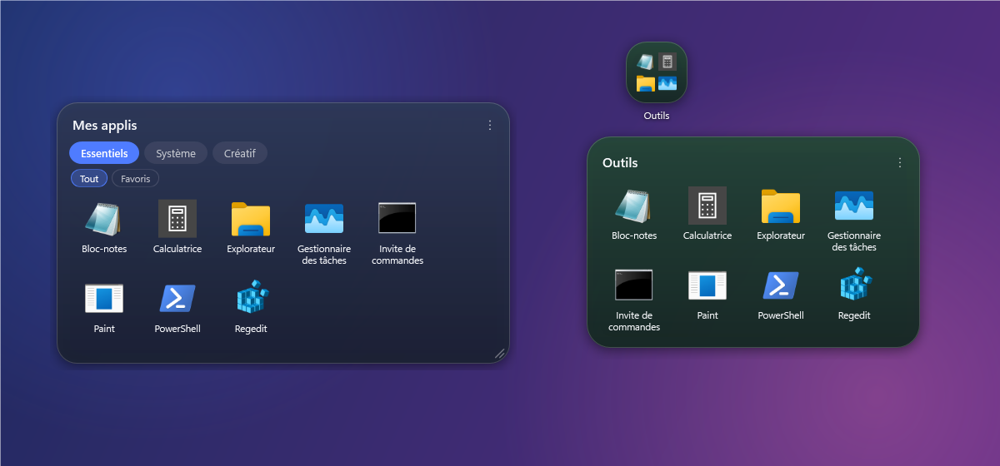
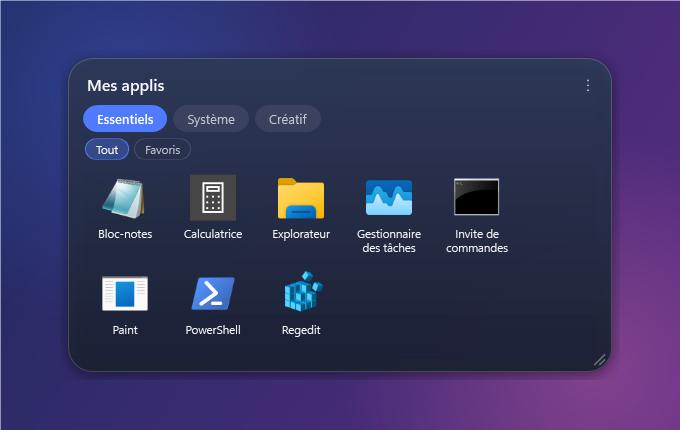
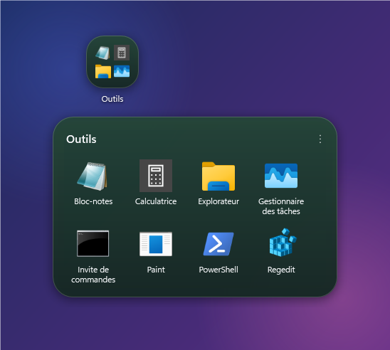

<p align="center">
  
</p>

<h1 align="center">BetterFences</h1>

<p align="center">
  Des dossiers d'applications façon Android, posés directement sur le bureau Windows.<br>
  Onglets, sous-onglets, glisser-déposer, et import de vos fences existantes.
</p>

<p align="center">
  <a href="../../releases/latest"><b>⬇ Télécharger l'installateur</b></a>
</p>



## Fonctionnalités

- **Deux modes par dossier**
  - **Panneau** : toujours ouvert sur le bureau, redimensionnable, réductible à sa barre de titre (double-clic).
  - **Icône** : une tuile avec l'aperçu de 4 applis ; un clic ouvre le dossier dans une fenêtre animée, comme sur Android.
- **Onglets et sous-onglets** pour classer les raccourcis (ex. *Jeux → Favoris*). La barre de sous-onglets n'apparaît que s'il y en a plusieurs.
- **Glisser-déposer**
  - Déposez un raccourci, un programme ou un fichier sur un dossier pour l'ajouter.
  - Réorganisez les icônes, ou glissez-les vers un autre onglet.
  - Glissez une icône hors du dossier pour la remettre sur le bureau.
- **Rangement du bureau** : les raccourcis déposés sont déplacés dans `%AppData%\BetterFences\Items` et restaurés à leur emplacement d'origine si vous supprimez le dossier. Aucun fichier n'est jamais supprimé.
- **Import depuis Fences** : retrouve vos fences, leurs onglets et leurs positions. La configuration Fences est seulement lue, jamais modifiée.
- **Import d'un dossier Windows** : crée un dossier BetterFences à partir de n'importe quel répertoire.
- **Collé au bureau** : les dossiers restent visibles après *Win + D* et n'apparaissent ni dans la barre des tâches ni dans *Alt + Tab*.
- **Icônes nettes** : chaque icône est chargée dans sa plus grande taille disponible, y compris pour les raccourcis Steam ou Ubisoft.
- **Zone de notification** : nouveau dossier, verrouillage des positions, masquer/afficher, imports, lancement avec Windows.

| Mode panneau | Mode icône |
| :---: | :---: |
|  |  |

## Installation

1. Téléchargez `BetterFences-Setup-x.y.z.exe` depuis la [dernière release](../../releases/latest).
2. Lancez-le. Aucun droit administrateur n'est nécessaire : l'appli s'installe dans `%LocalAppData%\Programs\BetterFences`.
3. Laissez cochée l'option **Lancer BetterFences au démarrage de Windows** si vous le souhaitez.

.NET est inclus : rien d'autre à installer. Windows 10 ou 11 (64 bits).

Au premier lancement, si une configuration Fences est trouvée, BetterFences propose de l'importer. Quittez ensuite Fences pour éviter que les deux se superposent.

## Utilisation

| Action | Comment |
| --- | --- |
| Créer un dossier | Clic droit sur l'icône de la zone de notification → *Nouveau dossier* |
| Ajouter des applis | Glisser-déposer depuis le bureau ou l'Explorateur |
| Lancer une appli | Clic sur son icône |
| Déplacer un dossier | Glisser sa barre de titre (ou sa tuile en mode icône) |
| Passer en mode icône / panneau, renommer, couleur, onglets | Clic droit sur le dossier ou le bouton `⋮` |
| Réduire un panneau | Double-clic sur sa barre de titre |
| Masquer tous les dossiers | Double-clic sur l'icône de la zone de notification |

Les données (configuration et raccourcis rangés) sont dans `%AppData%\BetterFences`. Elles sont conservées si vous désinstallez l'application.

## Compiler depuis les sources

Prérequis : [SDK .NET 9](https://dotnet.microsoft.com/download/dotnet/9.0) et, pour l'installateur, [Inno Setup 6](https://jrsoftware.org/isdl.php).

```powershell
# Lancer en développement
dotnet run --project src/BetterFences

# Publier et générer l'installateur dans dist\
powershell -ExecutionPolicy Bypass -File tools/build-installer.ps1
```

Outils annexes :

- `tools/make-icon.ps1` régénère l'icône de l'application.
- La variable `BETTERFENCES_DATA=<dossier>` utilise un autre dossier de données (pratique pour tester sans toucher à sa configuration).
- La variable `BETTERFENCES_SNAPSHOT=<dossier>` enregistre chaque fenêtre en PNG transparent puis ferme l'appli (captures du README).

## Structure

```
src/BetterFences/
  Models/      dossiers, onglets, sous-onglets, raccourcis
  Services/    configuration, stockage des raccourcis, icônes, imports, démarrage…
  Views/       fenêtres panneau / icône / popup et contenu partagé
  Themes/      styles « Android » (coins arrondis, pastilles, menus sombres)
installer/     script Inno Setup
tools/         génération de l'icône et de l'installateur
```

## Avertissement

BetterFences est un projet indépendant. Il n'est ni affilié à Stardock ni approuvé par Stardock ; « Fences » est une marque de Stardock Corporation, citée uniquement pour la fonction d'import.
